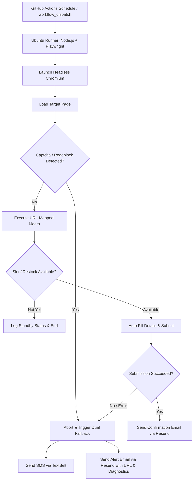

# Page Watcher 🕵️‍♂️⚡

An automated, serverless web-scraping and **"wait-and-act"** pipeline powered by **Playwright (Node.js)** and **GitHub Actions**.

It monitors dynamic web pages on a cloud schedule (GitHub Actions Cron) for state changes (such as event RSVP slots opening or e-commerce inventory restocks). When a slot becomes available, it executes an automated macro to fill in credentials and submit. If it encounters a roadblock (Cloudflare challenge, Google reCAPTCHA, or execution timeout), it immediately triggers a dual fallback alerting system via **SMS (TextBelt)** and **Email (Resend)** with a direct link to the page and error diagnostics so you can take action manually.

---

## 📋 Architecture & Features



### Key Highlights:
1. **Cloud Scheduled (Zero Local Compute)**: Runs in GitHub Actions every 15 minutes by default (customizable to 5 min, hourly, etc.).
2. **Dynamic Automation Macros**: Dictionary mapping URLs to custom automation flows (RSVP form filler, inventory restock cart trigger, etc.).
3. **Proactive Bot Detection**: Scans for Cloudflare Turnstile, Cloudflare Challenge walls, Google reCAPTCHA (v2/v3/invisible), and hCaptcha before and during interactions.
4. **Instant Dual Fallback Alerts**:
   - **TextBelt SMS**: Fast text alerts with target URL.
   - **Resend Email**: Rich HTML alert with direct click-through link and technical error details.
   - Alerts fire simultaneously via `Promise.allSettled`.
5. **Success Confirmation**: Sends an email via Resend when a macro successfully completes.
6. **Diagnostic Artifacts**: Automatically saves full-page screenshots on error and uploads them as GitHub Action run artifacts.

---

## 🛠️ Project Structure

```
├── .github/
│   └── workflows/
│       └── monitor-schedule.yml   # GitHub Actions cron workflow
├── src/
│   ├── index.js                  # Main orchestrator & headless runner
│   ├── captchaDetector.js        # Proactive Cloudflare / reCAPTCHA detector
│   ├── alertService.js           # TextBelt SMS & Resend Email alerting
│   └── macros.js                 # Target URL registry & automation macros
├── .env.example                  # Template for local testing
├── .gitignore
└── package.json
```

---

## ⚙️ Configuration & GitHub Secrets

To run this pipeline in GitHub Actions, navigate to your GitHub Repository:
**Settings > Secrets and variables > Actions > New repository secret** and add:

| Secret Name | Description | Example |
|---|---|---|
| `RESEND_API_KEY` | Your Resend API Key | `re_123456789_abcdefg` |
| `ALERT_EMAIL_TO` | Email address to receive alerts | `you@example.com` |
| `ALERT_EMAIL_FROM` | Sender address (or `onboarding@resend.dev`) | `alerts@yourdomain.com` |
| `TEXTBELT_API_KEY` | TextBelt key (`textbelt` for 1 free test/day) | `your_textbelt_key` |
| `ALERT_PHONE_NUMBER`| Phone number for SMS alerts | `+1234567890` |
| `REGISTRATION_NAME` | Name filled into RSVP forms | `Jane Doe` |
| `REGISTRATION_EMAIL`| Email filled into RSVP forms | `jane.doe@example.com` |
| `REGISTRATION_PHONE`| Phone filled into RSVP forms | `5551234567` |

---

## 🚀 Local Development & Testing

### 1. Install Dependencies
```bash
npm install
npx playwright install chromium
```

### 2. Configure Local Environment
```bash
cp .env.example .env
# Edit .env with your credentials
```

### 3. Run Locally
```bash
# Run with default headless mode:
npm start

# Or test with visible browser window:
HEADLESS=false npm start
```

---

## ⏱️ Modifying the Cron Schedule

Open [`.github/workflows/monitor-schedule.yml`](.github/workflows/monitor-schedule.yml) and edit the `schedule` block:

```yaml
on:
  schedule:
    # Every 15 minutes (default):
    - cron: '*/15 * * * *'

    # Every 5 minutes:
    # - cron: '*/5 * * * *'

    # Top of every hour:
    # - cron: '0 * * * *'

    # Mon-Fri every 10 min between 9am and 5pm UTC:
    # - cron: '*/10 9-17 * * 1-5'
```

You can also trigger runs manually at any time from the GitHub UI using **Actions > Scheduled Page Watcher > Run workflow**.

---

## 🧩 Adding Custom Target URLs & Macros

In [`src/macros.js`](src/macros.js), register your target URLs in `urlMacroRegistry`:

```javascript
export const urlMacroRegistry = {
  // Map an RSVP target URL to the rsvpMacro
  'https://myevent.com/rsvp-page': rsvpMacro,

  // Map an inventory item to the restockMacro
  'https://shop.com/products/sneaker-drop': restockMacro,

  // Or create your own custom macro:
  'https://example.com/custom': async ({ page, targetUrl }) => {
    // Custom steps here...
    return { triggered: true, actionSummary: 'Custom action executed' };
  }
};
```
